# iONiX Games — Website Documentation

A full reference for the iONiX Games studio website: every page, what's on it, how it works, and where everything lives.

| | |
|---|---|
| **Live site** | https://devangsharma28.github.io/ionixgames/ |
| **Repository** | https://github.com/DevangSharma28/ionixgames (branch `main`) |
| **Hosting** | GitHub Pages, deployed automatically on every push to `main` |
| **Built with** | Plain HTML, CSS and JavaScript — no framework, no build step. three.js r128 (from cdnjs) for the 3D port on the home page |
| **Fonts** | Lilita One (display) and Nunito (body), from Google Fonts |
| **Analytics** | Google Analytics 4 (`G-9BS32RXRXR`) with a consent banner |
| **Contact** | ionixgames26@gmail.com · Instagram [@ionix_games.in](https://www.instagram.com/ionix_games.in/) |
| **Screenshots taken** | 9 November 2026 — desktop at 1440 px wide, phone at 390 px wide (2× pixel density) |

---

## Contents

1. [Site map](#1-site-map)
2. [Shared layout (on every page)](#2-shared-layout-on-every-page)
3. [Home](#3-home--indexhtml)
4. [Games](#4-games--gameshtml)
5. [Ion Engine](#5-ion-engine--ion-enginehtml)
6. [About](#6-about--abouthtml)
7. [Contact](#7-contact--contacthtml)
8. [Privacy Policy](#8-privacy-policy--privacyhtml)
9. [404 — Page Not Found](#9-404--page-not-found--404html)
10. [Game catalog](#10-game-catalog)
11. [Analytics events](#11-analytics-events)
12. [SEO and sharing](#12-seo-and-sharing)
13. [Performance](#13-performance)
14. [Files and deployment](#14-files-and-deployment)
15. [Issues and to-dos found](#15-issues-and-to-dos-found)

---

## 1. Site map

| # | Page | File | Title tag | Desktop shot | Phone shot |
|---|---|---|---|---|---|
| 01 | Home | `index.html` | Ionix \| Independent Game Studio | [view](screenshots/desktop/01-home.png) | [view](screenshots/mobile/01-home.png) |
| 02 | Games | `games.html` | Games \| Ionix Studio | [view](screenshots/desktop/02-games.png) | [view](screenshots/mobile/02-games.png) |
| 03 | Ion Engine | `ion-engine.html` | Ion Engine \| Ionix Studio | [view](screenshots/desktop/03-ion-engine.png) | [view](screenshots/mobile/03-ion-engine.png) |
| 04 | About | `about.html` | About \| Ionix Studio | [view](screenshots/desktop/04-about.png) | [view](screenshots/mobile/04-about.png) |
| 05 | Contact | `contact.html` | Contact \| Ionix Studio | [view](screenshots/desktop/05-contact.png) | [view](screenshots/mobile/05-contact.png) |
| 06 | Privacy Policy | `privacy.html` | Privacy Policy \| Ionix Studio | [view](screenshots/desktop/06-privacy.png) | [view](screenshots/mobile/06-privacy.png) |
| 07 | 404 | `404.html` | Page Not Found \| Ionix | [view](screenshots/desktop/07-404.png) | [view](screenshots/mobile/07-404.png) |

```
Home ─┬─ Games ──────── Google Play / CrazyGames (external)
      ├─ Ion Engine
      ├─ About
      ├─ Contact ────── Google Form, email, Instagram, Discord
      └─ Privacy Policy (footer link)
```

---

## 2. Shared layout (on every page)

**Header / navbar**
- iONiX Games logo (links home).
- Menu: **Home · Games · Ion Engine · About · Contact**. The current page is highlighted as a yellow pill.
- **Idle wallet**: a coin counter that ticks up by +3/s while you're on the site, plus a gem counter. Clicking it gives a bonus. It's a playful touch with no real value.
- **Get In Touch** button → Contact page.
- On phones the menu collapses into a hamburger button that opens a dropdown.

**Background**
- Lavender-to-peach sky gradient with drifting cartoon clouds and a soft sun glow.
- A small scroll-progress bar at the top of the page.

**Footer**
- A green "grass" strip with a scalloped top edge.
- © 2026 Ionix Studio · Juice King Tycoon on Google Play · Instagram · Privacy Policy · Cookie settings.

**Effects used across pages**
- Buttons have a "magnetic" pull toward the cursor and a ripple when clicked.
- Cards tilt in 3D when hovered (desktop only).
- Game cards pop in as you scroll down.
- Clicking a Google Play button sends out a burst of fruit and coins.
- Everything calms down for visitors who have "reduce motion" turned on in their device settings.

**Consent banner**
- Visitors whose time zone is in Europe see a cookie banner before analytics turns on. Anyone can reopen it from **Cookie settings** in the footer.
- The site shows no ads, and ad storage is always off.

---

## 3. Home — `index.html`

**Purpose:** introduce the studio, show off the games, and point people to play them or get in touch.

### Sections (top to bottom)

1. **Hero**
   - Tags: "Independent Game Studio · Web · Mobile".
   - A big multicolour **IONIX** headline.
   - Tagline: *"We build games you can't put down — and the engine behind them."*
   - Intro card: *"Small team, high voltage. Every title we ship is hand-crafted for game feel first, and every lesson goes back into Ion Engine."*
   - Buttons: **Play Our Games** → Games, **Ion Engine** → Ion Engine.
   - **Live 3D cargo port** (right side on desktop, below the buttons on phones) — details below.
2. **Stats row**: **4** games live / in dev · **2+** years building worlds · **2** platforms — mobile · web.
3. **01 — Now Playing: "Our latest hit"**
   - A big banner for **Idle Bakery Cafe**: logo, "Live on Google Play", *"Bake, brew & earn — turn a tiny drive-through into the busiest bakery cafe in town. Free to play."*
   - Buttons: **Play Free** → Google Play, **All Games** → Games.
   - The banner tilts and its art shifts slightly as the mouse moves.
4. **Ticker**: a pink scrolling ribbon — Game Feel ✦ Ion Engine ✦ Unity ✦ Three.js ✦ WebGL ✦ Level Design.
5. **02 — The Lineup**: one row per game with icon, name, short description, genre, platforms and status (see [Game catalog](#10-game-catalog)). Ends with an **All Games** button.
6. **03 — Feel Lab: "Don't read about it. Play it."**
   - A 12-second mini-game in a phone frame: tap the coins before the timer runs out.
   - Spec list: round length 12 s · combo window 900 ms · built with vanilla JS.
   - Shows your coin count at the end, with a **Replay** button.
7. **04 — Coming Soon: Ion Engine**
   - Text: *"Every game we ship teaches us something about the tools we wish we had…"*
   - **Explore The Engine** button.
   - A fake terminal (`ION://TERMINAL v0.9 — PREVIEW`) types out an `ion init` / `ion build` session when it scrolls into view.
8. **05 — Let's Talk**: a giant *"Let's make something loud."* headline with a **Start A Conversation** button → Contact.

### The 3D cargo port (`ionix-island.js`)

A cartoon-style floating port that runs in a loop:
- A container ship sails in with a tug.
- Two yellow quay cranes unload its boxes onto six trucks.
- Purple yard gantry cranes stack the boxes, and each stacked box pops a coin.
- When the ship is empty it sails away, the yard "sells" its stack in a burst of coins, and a new full ship arrives. One cycle takes about 70 seconds.
- In the background: a freight train, seagulls, clouds, rippling water and blinking crane lights.

**Interaction:**
- Tapping the port gives 25 coins to the idle wallet.
- The mouse tilts the scene slightly.
- The first visit each session shows a short "Building your port…" loading screen.

**Performance:**
- 74 draw calls and about 25k triangles per frame.
- Phones are capped at 30 fps.
- It pauses when scrolled off screen.
- It lowers its resolution automatically if a device struggles.
- Visitors with "reduce motion" on see a still image instead.

### Screenshots

**Desktop**

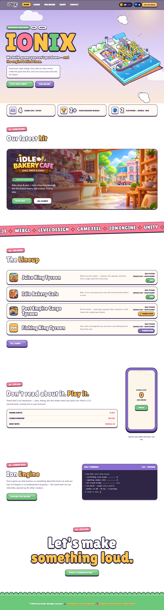

**Phone**


---

## 4. Games — `games.html`

**Purpose:** the full game catalog, with store links.

### Sections

1. **Featured poster**: a full-width **Idle Bakery Cafe** poster tagged "New & Live" — *"Bake, brew & earn — build the coziest cafe in town!"* — with a **Play Now** button. The whole poster links to Google Play.
2. **Header**: *"Our Games"* — *"Idle tycoon games for Google Play and CrazyGames — two live, more on the way."*
3. **Game grid** (two columns on desktop, one on phones). Each card has key art with the game's logo on top, a genre/status tag, a description and platform badges:
   - **Juice King Tycoon** — Live — **Get It On Google Play**
   - **Idle Bakery Cafe** — Live — **Get It On Google Play** + **Play On CrazyGames**
   - **Port Empire Cargo Tycoon** — Coming Soon — new sunset port art, logo and icon (updated 9 November 2026)
   - **Fishing King Tycoon** — Coming Soon — uses the generic "iONiX Coming Soon" art
4. **Feedback**: *"Got Feedback On A Build?"* — *"We read everything — bug reports, wishlist requests, and everything in between."* — **Contact Us** button.

The page also contains structured data (`MobileApplication`) for Juice King Tycoon and Idle Bakery Cafe, so search engines can recognise them as apps.

### Screenshots

**Desktop**

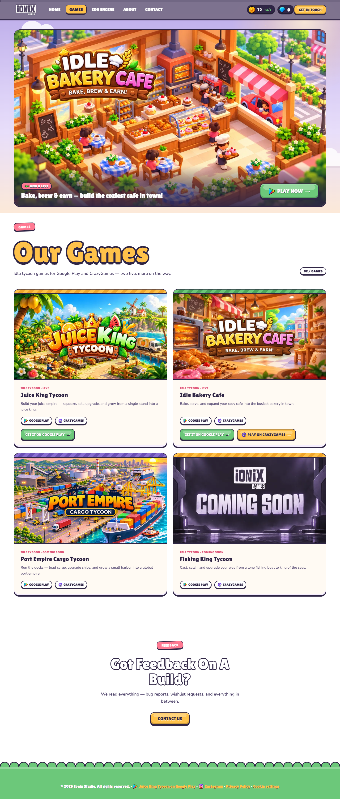

**Phone**

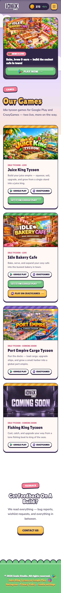

---

## 5. Ion Engine — `ion-engine.html`

**Purpose:** a placeholder for the studio's in-house engine.

**Content:** currently only an "Ion Engine" tag and a big **Coming Soon** heading, with the standard header and footer. The home page's Ion Engine teaser and the About page describe the engine in more detail than this page does.

### Screenshots

**Desktop**

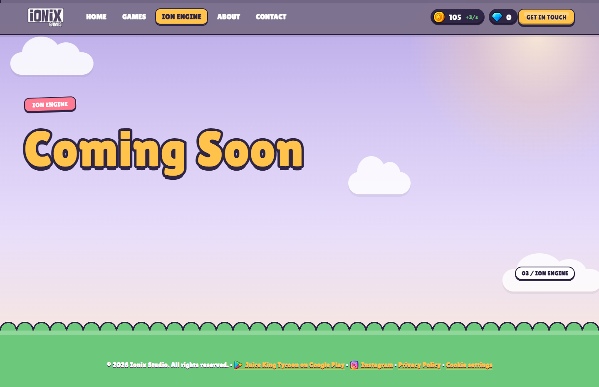

**Phone**

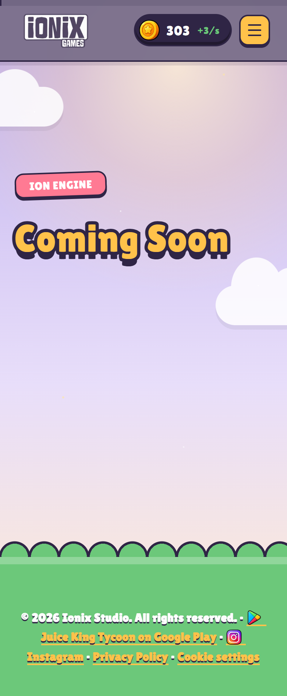

---

## 6. About — `about.html`

**Purpose:** the studio's story, how it works, and its milestones.

### Sections

1. **Header**: *"About Ionix"* — *"A small team making original games — and building the engine we wished we had along the way."*
2. **Story**
   - *"Ionix started with a simple frustration: most tools force a trade-off between speed and control…"*
   - The team works on gameplay systems, AI behaviour, camera work and UI feel, with a focus on scalable architecture, clean code and performance.
3. **Fact sheet**

   | Item | Value |
   |---|---|
   | Based | Remote-first studio |
   | Founded | 2024 |
   | Focus | Original games & engine tooling |
   | Team | Small, multidisciplinary |
   | Availability | Open to publishing & collaboration |

4. **Process — "How We Build"** (five numbered steps)
   - **01 Concept**: one mechanic that reads in under 3 seconds.
   - **02 Prototype**: grey-box it the same week.
   - **03 Build**: in Unity or Ion Engine.
   - **04 Polish**: playtest and tune feel.
   - **05 Ship**: per-platform builds, QA on real hardware.
5. **Milestones & Recognition**: three cards — First Title Shipped, Community-Backed Beta, Building In The Open. ⚠️ These are still **placeholder text** (see [Issues](#15-issues-and-to-dos-found)).

### Screenshots

**Desktop**

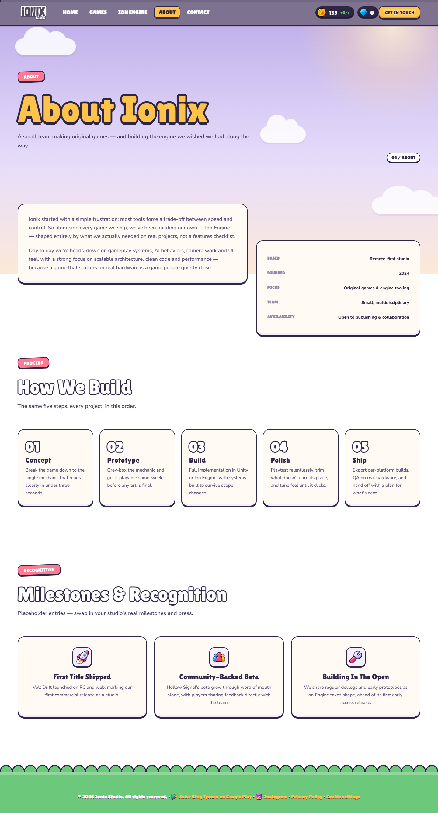

**Phone**

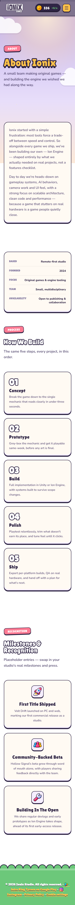

---

## 7. Contact — `contact.html`

**Purpose:** let press, publishers, collaborators and players reach the studio.

### Sections

1. **Header**: *"Contact Us"* — *"Press, publishing, collaboration, bug reports, or just saying hi — we read every message."*
2. **Contact form**
   - Fields: Name, Email, Subject, Message (plus a hidden "Website" field that catches spam bots).
   - **Send Message** posts the entry to a **Google Form**, so messages arrive in that form's responses.
   - Analytics records `generate_lead` when a message is sent and `contact_form_error` when it fails.
3. **Reach Us Directly**
   - Email ionixgames26@gmail.com; response time "within 2–3 business days".
   - **Discord** card: "Join server →" ⚠️ the link currently goes nowhere (`#`).
   - **Instagram** card: @ionix_games.in.
4. **Find Us Online**: Instagram and Email buttons.

### Screenshots

**Desktop**

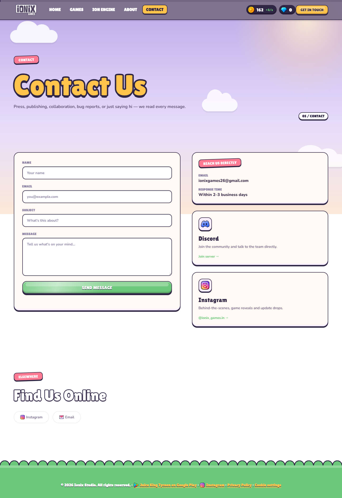

**Phone**

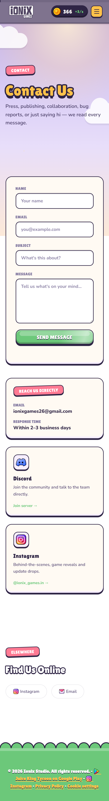

---

## 8. Privacy Policy — `privacy.html`

**Purpose:** the privacy policy for the studio's games and website (also needed for the Google Play and CrazyGames listings).

- **Effective date:** 29 October 2026.
- **Layout:** a sticky contents list on the left (desktop) that highlights the section you're reading, with the policy text on the right.
- **Sections:**
  1. Introduction
  2. Information we collect
  3. How we use it
  4. Third-party services
  5. How we share it
  6. EU / EEA users (GDPR)
  7. Children's privacy
  8. Data retention
  9. Data security
  10. Your advertising choices
  11. This website
  12. Changes to this policy
  13. Contact us
- **Key points:**
  - No accounts, and no names, addresses or phone numbers collected.
  - Collects device and usage data, IP address and approximate location (never GPS).
  - Personal data is never sold.
- **Third-party services listed:** Google AdMob, Unity Ads / Unity Analytics, GameAnalytics, Google Play, Apple App Store and Cloudflare, each linked to its own privacy policy.

### Screenshots

**Desktop**

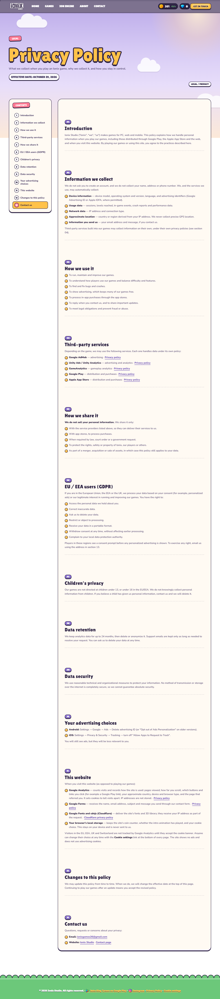

**Phone**


---

## 9. 404 — Page Not Found — `404.html`

**Purpose:** shown by GitHub Pages for any address that doesn't exist.

**Content:**
- *"Lost In The Clouds"* — *"This page doesn't exist. Head back home or check out our games."* — with links to Home and Games.
- Analytics records a `page_not_found` event.
- The page loads its files from `/ionixgames/…`, so it works at any broken address on the live site.

### Screenshots

**Desktop**

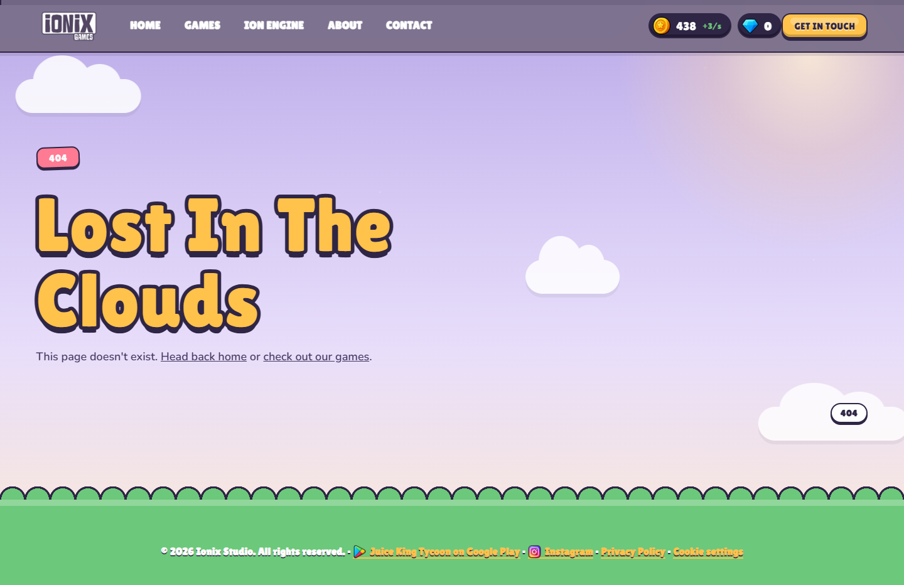

**Phone**

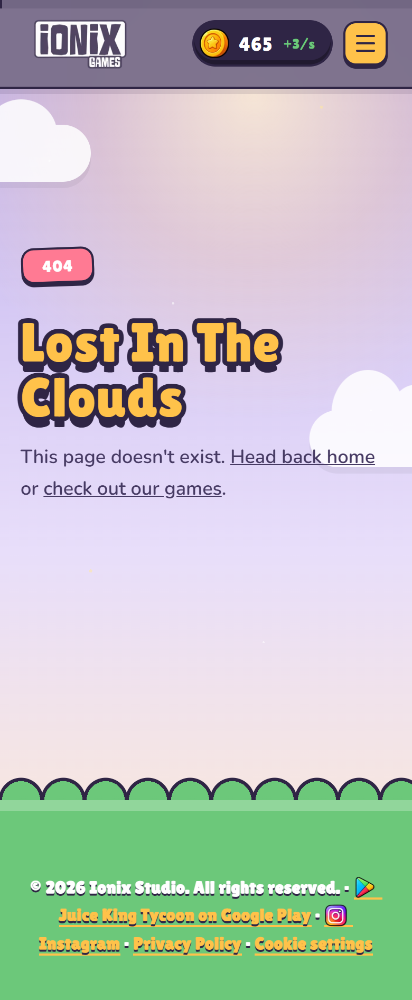

---

## 10. Game catalog

| Game | Genre | Status | Google Play | CrazyGames | Where it appears |
|---|---|---|---|---|---|
| **Juice King Tycoon** | Idle tycoon | Live | [com.ionixgames.juicekingtycoon](https://play.google.com/store/apps/details?id=com.ionixgames.juicekingtycoon) | listed as a platform (no link yet) | Home lineup, Games grid, footer |
| **Idle Bakery Cafe** | Idle tycoon | Live (featured) | [com.ionixgames.idlebakerycafe](https://play.google.com/store/apps/details?id=com.ionixgames.idlebakerycafe) | [Play on CrazyGames](https://www.crazygames.com/game/idle-bakery-cafe?bypassCache=tga1t&utm_source=copy_link&utm_medium=share_game) | Home banner + lineup, Games poster + grid |
| **Port Empire Cargo Tycoon** | Idle tycoon | Coming soon | — | — | Home lineup, Games grid; inspired the home page 3D port |
| **Fishing King Tycoon** | Idle tycoon | Coming soon | — | — | Home lineup, Games grid (no art yet) |

**Image files for each game** (all in `Games/web/`, WebP format):

| Game | Files |
|---|---|
| Juice King Tycoon | `juice-king-tycoon-art(-800)` · `-logo` · `-icon` |
| Idle Bakery Cafe | `idle-bakery-cafe-art(-800)` · `-poster(-800)` · `-logo` · `-icon` |
| Port Empire Cargo Tycoon | `port-empire-cargo-tycoon-art(-800)` · `-logo` · `-icon` |
| Fishing King Tycoon | none; uses `coming-soon-art(-800)` |

The full-size originals stay in each game's own folder (for example `Games/Port Empire Cargo Tycoon/`). They are not published to the live site.

---

## 11. Analytics events

Google Analytics 4 records these custom events, in addition to normal page views:

| Event | When it fires |
|---|---|
| `nav_click` | A menu link is clicked |
| `cta_click` | A main call-to-action button is clicked |
| `play_store_click` | Any Google Play link is clicked |
| `featured_poster_click` | The Idle Bakery Cafe poster on the Games page is clicked |
| `social_click` | An Instagram / social link is clicked |
| `email_click` | An email link is clicked |
| `placeholder_click` | A link that isn't set up yet (like Discord) is clicked |
| `wallet_tap` | The coin wallet in the header is clicked |
| `island_tap` | The 3D port on the home page is tapped (name kept from the old island so reports stay continuous) |
| `feel_lab_round` | A Feel Lab mini-game round finishes |
| `scroll_depth` | The visitor scrolls past set depths of a page |
| `generate_lead` | The contact form is sent |
| `contact_form_error` | The contact form fails to send |
| `page_not_found` | Someone lands on the 404 page |

**Consent:**
- Ad storage is always denied.
- Analytics is on by default outside Europe. Visitors in Europe are asked first.
- The choice is remembered in the browser.

---

## 12. SEO and sharing

- **Page titles and descriptions:** every page has its own title, meta description and canonical URL (see the table in section 1). The 404 page reuses the Ion Engine description (see [Issues](#15-issues-and-to-dos-found)).
- **Social share card:** `LOGO/social-card.jpg` (1200×630) is used for Open Graph / Twitter previews on every page.
- **Icons:** `LOGO/favicon.png` (64×64) and `LOGO/apple-touch-icon.png` (180×180).
- **Structured data:**
  - The Home page has `Organization` data (name, logo, email, Instagram).
  - The Games page has `MobileApplication` data for the two live games.
- **`sitemap.xml`** lists Home, Games, Ion Engine, About, Contact and Privacy. **`robots.txt`** allows everything and points to the sitemap.

---

## 13. Performance

Measured in headless Edge with the cache turned off, so every file downloads fresh. "Weight" is the total downloaded per page. It includes Google Fonts, Google Analytics and (Home only) three.js from cdnjs.

| Page | Desktop requests | Desktop weight | Phone requests | Phone weight | Full-page height (desktop / phone) |
|---|---|---|---|---|---|
| Home | 30 | 752 KB | 28 | 743 KB | 5,314 px / 6,707 px |
| Games | 27 | 966 KB | 27 | 851 KB | 3,375 px / 3,718 px |
| Ion Engine | 17 | 364 KB | 15 | 361 KB | 932 px / 946 px |
| About | 20 | 382 KB | 20 | 379 KB | 2,669 px / 4,682 px |
| Contact | 19 | 377 KB | 18 | 374 KB | 2,094 px / 2,866 px |
| Privacy | 17 | 377 KB | 16 | 373 KB | 6,522 px / 10,109 px |
| 404 | 19 | 368 KB | 16 | 361 KB | 932 px / 946 px |

**Where the weight comes from (Home, desktop):** scripts 375 KB (mostly three.js and Google Analytics) · images 207 KB · CSS 86 KB · fonts 48 KB · HTML 32 KB.

These figures come from a local test server that doesn't compress files. GitHub Pages gzips HTML, CSS and JS, so real downloads of those are smaller. Image sizes are the same either way.

**Optimizations in place:**
- **All images are WebP** (converted 9 November 2026): about 3.1 MB → 1.25 MB in total. Logos went from 160–260 KB to 34–55 KB each, and icons from about 15 KB to about 4 KB each.
- Game card art comes in two sizes (800 px and 1100/1600 px). Phones download the smaller one.
- Images below the first screen load only when scrolled near (`loading="lazy"`).
- The Games page poster is marked high priority so it appears first.
- Scripts load with `defer`, so they don't hold up the first paint.
- The deploy publishes only the files the pages use. The full-size source art stays out of the live site.
- The 3D port is heavily optimized (see [section 3](#3-home--indexhtml)).

---

## 14. Files and deployment

```
ionixgames/
├── index.html, games.html, ion-engine.html, about.html,
│   contact.html, privacy.html, 404.html     ← the 7 pages
├── style.css (39 KB)          base styles
├── ionix.css (46 KB)          cartoon theme, components, page sections
├── ionix.js (10 KB)           loader, idle wallet, terminal typing, privacy contents, banner tilt, coin bursts, pop-in reveal
├── ionix-island.js (60 KB)    the 3D cargo port on the home page
├── ionix-analytics.js (8 KB)  consent banner + GA4 events
├── robots.txt, sitemap.xml
├── LOGO/                      logo.webp (site), logo.png (structured data), favicon, apple-touch-icon, social-card, badge source
├── UIAtlas/web/               31 small UI icons (WebP, 96×96)
├── UIAtlas/icons/             full-size icon sources (not published)
├── Games/web/                 published game art, logos, icons (WebP)
├── Games/<Game name>/         full-size source art per game (not published)
├── .github/workflows/static.yml  GitHub Pages deploy
└── site-docs/                 this document + screenshots
```

Each page also has a short inline script for:
- the mobile menu
- the scroll-progress bar
- scroll reveal
- magnetic buttons
- card tilt
- Home only: the Feel Lab mini-game
- Contact only: the form

**Deployment:**
1. Pushing to `main` runs `.github/workflows/static.yml`.
2. The workflow copies the HTML, CSS, JS, `robots.txt`, `sitemap.xml`, `Games/web/`, `UIAtlas/web/` and the four `LOGO` files into a `_site` folder.
3. That folder is published to GitHub Pages.

The live site updates about a minute later. Browsers may keep old files for up to 10 minutes.

**Updating game art:**
1. Put the new full-size files in the game's folder.
2. Make web versions in `Games/web/`, keeping the same names, in WebP, at about 1100×619 for art, 800×450 for the small art, ~640 px wide for logos and 160×160 for icons.
3. If a logo's proportions change, update its `width`/`height` in the HTML.

---

## 15. Issues and to-dos found

Found while documenting the site; none of these are fixed yet.

| # | Page | Issue | Suggested fix |
|---|---|---|---|
| 1 | About | The **Milestones & Recognition** cards still show template text. It says *"Placeholder entries — swap in your studio's real milestones and press"* and mentions games that aren't yours (*Volt Drift*, *Hollow Signal*). Visitors can see this. | Replace with real milestones, e.g. Juice King Tycoon launch, Idle Bakery Cafe on Google Play + CrazyGames. Or hide the section. |
| 2 | Contact | The **Discord** card's "Join server" link goes nowhere (`#`). | Add the Discord invite link, or remove the card until there is one. |
| 3 | 404 | The meta description is copied from the Ion Engine page. | Give it its own description (it isn't indexed, so this is minor). |
| 4 | Ion Engine | The page is only a "Coming Soon" heading, while the home page sends people there with "Explore The Engine". | Add a short pitch, the terminal preview, or a sign-up / notify-me link. |
| 5 | Games / Home | Juice King Tycoon lists **CrazyGames** as a platform but has no CrazyGames link. Port Empire and Fishing King list both stores while still unreleased. | Add the CrazyGames link when it's live, or show only the live platforms. |
| 6 | Games | **Fishing King Tycoon** has no art of its own. | Add art, a logo and an icon when ready. |
| 7 | Repo | The WebP image change and the new Port Empire art are **not committed yet**. | Commit and push to publish them. |
